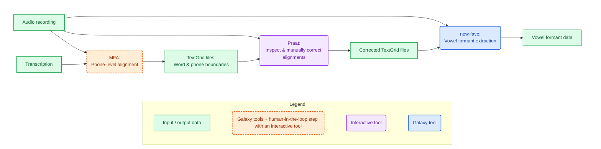

# Galaxy Special Interest Groups
Galaxy has many [Special Interest Groups](https://galaxyproject.org/community/sig/) (SIGs), some organised around scientific fields, some around shared methodologies, or some regional.
When I started at the Freiburg Galaxy Team, despite the many options to choose from, none of the above SIGs met my research profile.
What defines a community, and how do you create a new one?

## Community building in the Digital Humanities Special Interest Group - Step by Step and Tool by Tool
I have asked myself this question a lot since I started out with the Freiburg Galaxy Team.
Due to my background, it seemed only natural for me to start the [Digital Humanities and Social Sciences Special Interest Group](https://galaxyproject.org/community/sig/digital-humanities/) (DH SIG) and broaden the Galaxy in yet another dimension.
But how does one set up a new community from scratch?  
I drew on my expertise in Digital Humanities and created workflows and tutorials so others could get an idea of Galaxy's capabilities.
But the field is vast, and it was clear to me from the start that I would need lots of input from researchers across different fields to make Galaxy truly useful to a wide range of DH researchers.
I would need to transport my vision of DH's galactic journey (more than the status quo) if I wanted to build a community.

One of the people who saw this vision early on was [Jessica Wallace](https://github.com/wallajess). 
She is a researcher in the English Department at the University of Freiburg, is involved in the University's [Digital Humanities Lab](https://digitalhumanities.uni-freiburg.de/dh-lab) and has previously worked with the [NFDI consortium Text+](https://text-plus.org/). 
We had met several times - mostly around meetings of the University of Freiburg's [Central Data Facility (CDF)](https://uni-freiburg.de/cdf-en/) when I pitched her my vision. 
She accepted the challenge to create one of her usual linguistics workflows on Galaxy and
suggested adding two command-line tools: 
[Montreal Forced Aligner (MFA)](https://montreal-forced-aligner.readthedocs.io/) and [new fave](https://pypi.org/project/new-fave/).

## Adding new linguistics tools: Montreal Forced Aligner and new fave
The Montreal Forced Aligner breaks speech down into individual speech sounds and aligns these with their corresponding transcription. New fave can use this output to extract the vowel measurements for further analysis.

Both are command-line tools that require some technical knowledge, which can present a barrier for researchers accustomed to graphical user interfaces.
Wrapping MFA and new-fave for Galaxy made them accessible through a web interface. 
That way, researchers without programming skills could also use them.
My colleagues [Armin Dadras](https://github.com/dadrasarmin/) and [Wolfgang Maier](https://github.com/wm75) wrapped the tools and made them available as test tools.

Jessica tested extensively to identify where the tools needed improvements and what tweaks would make them even more useful on Galaxy.
For this, Jessica's domain knowledge, insights and enthusiasm were essential.
Once the tools were good to go, [Ivo Leist](https://github.com/IvoLeist/) ported them from the test status into Galaxy Toolshed-ready tools.
(If you want to read more on the technical process, stay tuned for Jessica's second step of the journey!)
Thanks to all of them, you can run new-fave and Montreal Forced Aligner directly on Galaxy. Click the buttons below to give them a try.

  <a class="btn btn-primary" href="https://ssh.usegalaxy.eu/?tool_id=toolshed.g2.bx.psu.edu/repos/bgruening/new_fave_extract/new_fave_extract" target="_blank" rel="noopener noreferrer">new-fave</a>

 

  <a class="btn btn-primary" href="https://ssh.usegalaxy.eu/?tool_id=toolshed.g2.bx.psu.edu/repos/bgruening/mfa_align/mfa_align" target="_blank" rel="noopener noreferrer">MFA Align</a>

  
{"Reveal/Hide buttons pointing to the other 13 MFA tools on Galaxy Europe."}

  <h4>Validation</h4>
  

    <a class="btn btn-primary" href="https://ssh.usegalaxy.eu/?tool_id=toolshed.g2.bx.psu.edu/repos/bgruening/mfa_validate/mfa_validate" target="_blank" rel="noopener noreferrer">Validate</a>
    <a class="btn btn-primary" href="https://ssh.usegalaxy.eu/?tool_id=toolshed.g2.bx.psu.edu/repos/bgruening/mfa_validate_dictionary/mfa_validate_dictionary" target="_blank" rel="noopener noreferrer">Validate Dictionary</a>
    <a class="btn btn-primary" href="https://ssh.usegalaxy.eu/?tool_id=toolshed.g2.bx.psu.edu/repos/bgruening/mfa_find_oovs/mfa_find_oovs" target="_blank" rel="noopener noreferrer">Find OOVs</a>
  

  <h4>Training &amp; Adaptation</h4>
  

    <a class="btn btn-primary" href="https://ssh.usegalaxy.eu/?tool_id=toolshed.g2.bx.psu.edu/repos/bgruening/mfa_train/mfa_train" target="_blank" rel="noopener noreferrer">Train</a>
    <a class="btn btn-primary" href="https://ssh.usegalaxy.eu/?tool_id=toolshed.g2.bx.psu.edu/repos/bgruening/mfa_train_dictionary/mfa_train_dictionary" target="_blank" rel="noopener noreferrer">Train Dictionary</a>
    <a class="btn btn-primary" href="https://ssh.usegalaxy.eu/?tool_id=toolshed.g2.bx.psu.edu/repos/bgruening/mfa_train_g2p/mfa_train_g2p" target="_blank" rel="noopener noreferrer">Train G2P</a>
    <a class="btn btn-primary" href="https://ssh.usegalaxy.eu/?tool_id=toolshed.g2.bx.psu.edu/repos/bgruening/mfa_train_lm/mfa_train_lm" target="_blank" rel="noopener noreferrer">Train LM</a>
    <a class="btn btn-primary" href="https://ssh.usegalaxy.eu/?tool_id=toolshed.g2.bx.psu.edu/repos/bgruening/mfa_train_tokenizer/mfa_train_tokenizer" target="_blank" rel="noopener noreferrer">Train Tokenizer</a>
    <a class="btn btn-primary" href="https://ssh.usegalaxy.eu/?tool_id=toolshed.g2.bx.psu.edu/repos/bgruening/mfa_adapt/mfa_adapt" target="_blank" rel="noopener noreferrer">Adapt</a>
  

  <h4>Utilities</h4>
  

    <a class="btn btn-primary" href="https://ssh.usegalaxy.eu/?tool_id=toolshed.g2.bx.psu.edu/repos/bgruening/mfa_g2p/mfa_g2p" target="_blank" rel="noopener noreferrer">G2P</a>
    <a class="btn btn-primary" href="https://ssh.usegalaxy.eu/?tool_id=toolshed.g2.bx.psu.edu/repos/bgruening/mfa_tokenize/mfa_tokenize" target="_blank" rel="noopener noreferrer">Tokenize</a>
    <a class="btn btn-primary" href="https://ssh.usegalaxy.eu/?tool_id=toolshed.g2.bx.psu.edu/repos/bgruening/mfa_remap_alignments/mfa_remap_alignments" target="_blank" rel="noopener noreferrer">Remap Alignments</a>
    <a class="btn btn-primary" href="https://ssh.usegalaxy.eu/?tool_id=toolshed.g2.bx.psu.edu/repos/bgruening/mfa_merge/mfa_merge" target="_blank" rel="noopener noreferrer">Merge</a>
  

## From Tools to Workflow to Trainings
Making the tools accessible outside of command-line settings can already be super helpful for many researchers.
But the real power of Galaxy lies in creating [workflows](https://gxy.io/GTN:T00163) by chaining several tools together to create a reproducible pipeline.
This is particularly useful because MFA includes many sub-tools for specific tasks. 
In a workflow, they can be easily combined and adjusted to a user's needs.
Those workflows can be used as a basis for writing tutorials for the [Galaxy Training Network](https://training.galaxyproject.org/training-material/) to support the community in using those tools.
Jessica did just that by contributing a tutorial on [how to use Montreal Forced Aligner](https://gxy.io/GTN:T00585) to align speech recordings with their transcriptions, providing the foundation for subsequent vowel formant extraction with new-fave.
That way, she opened the door to showcasing how Galaxy could be useful for linguists and broadened the Galaxy DH SIG even more.
But her regular analysis still included [Praat](https://praat.org/), an interactive phonetics tool not yet available on Galaxy. Below you see an schematic overview over the whole envisioned workflow.

<MermaidEmbed>

</MermaidEmbed>

Stay tuned to read more on Jessica's galactic journey and how we are growing the DH community on Galaxy step by step and tool by tool.
